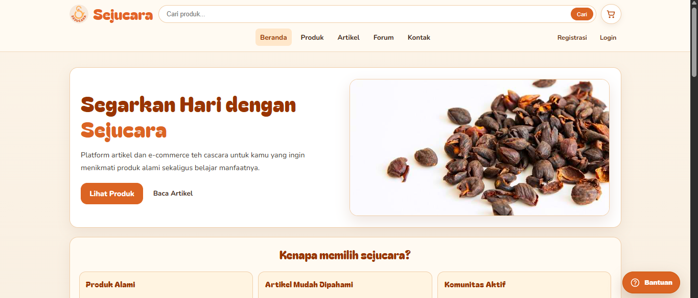

# Sejucara — Web Application

## About the Project

Sejucara is a web application developed using Laravel, PHP, and MySQL.

This project demonstrates practical experience in web application development, backend implementation, database integration, and website customization.

## Project Information

- **Project Name:** Sejucara
- **Project Type:** Web Application
- **Framework:** Laravel
- **Programming Language:** PHP
- **Database:** MySQL

## Live Website

Visit the deployed website:

https://sejucara.my.id/

## Technologies Used

- **Laravel** — PHP web application framework.
- **PHP** — Server-side programming language.
- **MySQL** — Relational database management system.

## Key Highlights

- Web application development using Laravel.
- Database integration using MySQL.
- Backend implementation and application structure.
- Website deployment and maintenance.

## Project Screenshots

### Homepage

## Developer

**Rifqi Aini Wahdaniyatillahi**

S1 Informatics Engineering graduate interested in IT Business Analysis, Web Development, UI/UX Design, and user-centered digital solutions.

## Repository Information

This repository contains the source code for the Sejucara web application.

For setup instructions, refer to the project configuration files and Laravel documentation.

---

*Part of my software development portfolio.*
